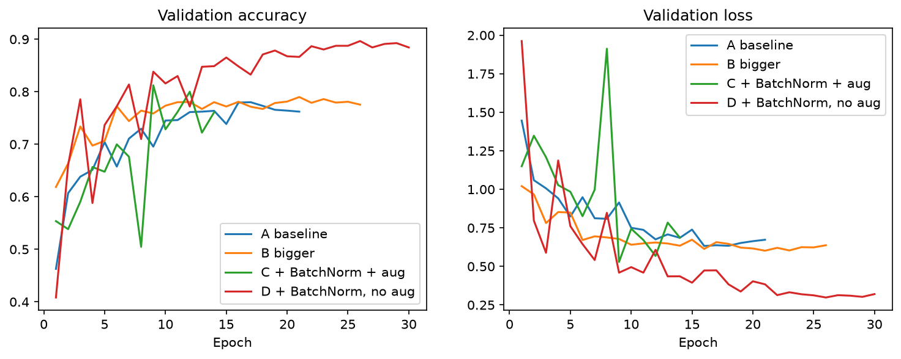
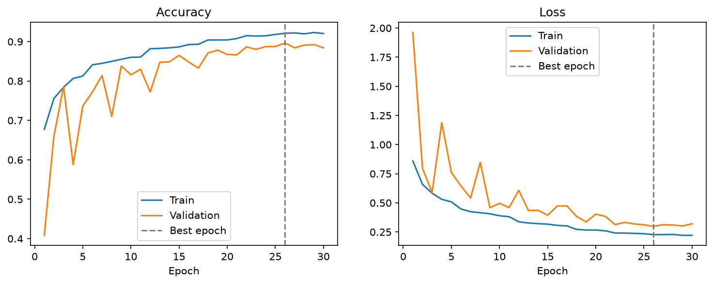
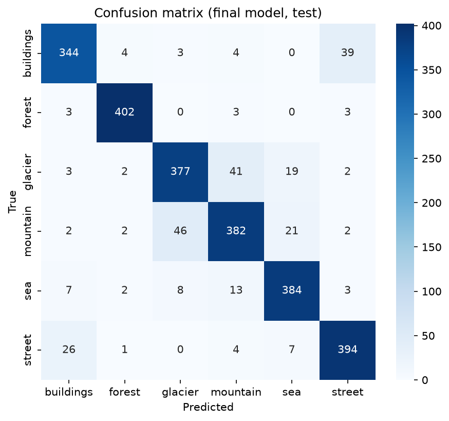
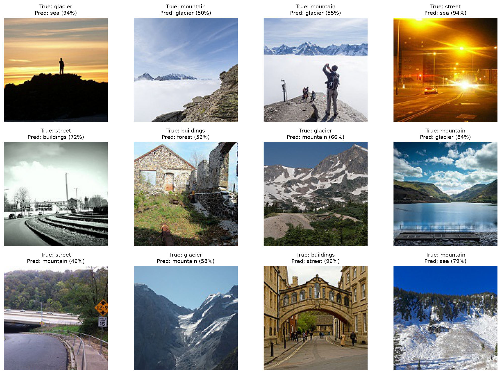
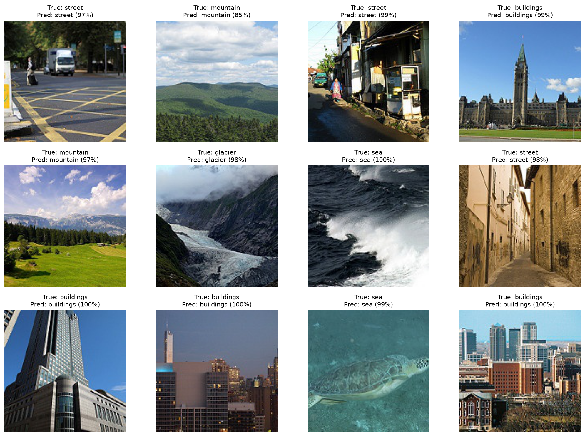
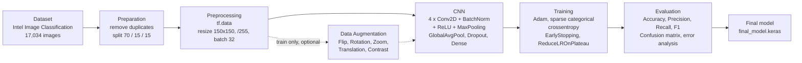
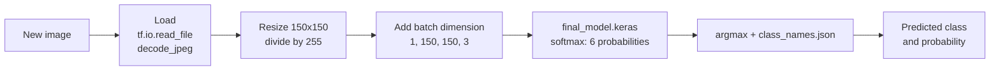

# SceneVision: Image Classification with a CNN (TensorFlow/Keras)

## 1. Project description
A company wants to analyze images automatically and find the type of
environment shown. This project builds a Deep Learning model (a CNN) that
takes an image and predicts its category with a probability.

Goals:
- Classify a new image and return the class and its probability.
- Measure the performance of the model.
- Analyze the errors.
- Improve the model step by step.

## 2. Dataset
**Intel Image Classification** (Kaggle, by Puneet Bansal):
https://www.kaggle.com/datasets/puneet6060/intel-image-classification

- About 17,000 labeled images (150x150, JPEG) in 6 classes:
  `buildings`, `forest`, `glacier`, `mountain`, `sea`, `street`.
- The dataset is balanced: from 2,628 (buildings) to 3,037 (mountain)
  images per class.
- The dataset is not in the repository (it is too big). Download it and
  unzip it in `data/`, so you have `data/seg_train_test/seg_train/`.

## 3. Data preparation
- 18 duplicate images were found (same file hash) and removed, to avoid
  data leakage. 17,016 images remain.
- No corrupted files. All files are JPEG. A few images do not have the
  size 150x150.
- The data is split with `stratify` (same class proportions in each set)
  and `random_state=42`:

| Set | Images | Role |
|---|---|---|
| Train | 11,911 (70%) | The model learns from it |
| Validation | 2,552 (15%) | Tuning, EarlyStopping, choice of the best epoch |
| Test | 2,553 (15%) | One final score on unseen data |

## 4. Preprocessing
- Resize to 150x150.
- Normalization: pixel values divided by 255 (range 0 to 1).
- Labels converted to numbers 0 to 5 (alphabetical order).
- Loading with `tf.data`, batch size 32, shuffle on train only, prefetch.
- The same preprocessing is used for validation, test, and new images.

## 5. Data Augmentation
Augmentation is applied on the **train set only**, never on validation or test.
It was tested with these settings:

| Transformation | Value |
|---|---|
| RandomFlip | horizontal |
| RandomRotation | 0.1 |
| RandomZoom | 0.1 |
| RandomTranslation | 0.1 |
| RandomContrast | 0.1 |

Role: each epoch, the model sees a slightly different version of each photo,
so it cannot memorize them.

**Impact:** with these settings, augmentation caused underfitting. The same
model reached 0.815 test accuracy with augmentation and **0.894 without it**
(see section 8). The settings were too strong for small 150x150 images and
this small model. The **final model is trained without augmentation**.

## 6. CNN architecture (final model)

```
Input (150x150x3)
-> 4 blocks: Conv2D (3x3) -> BatchNormalization -> ReLU -> MaxPooling2D (2x2)
   with 32, 64, 128, 256 filters
-> GlobalAveragePooling2D
-> Dropout (0.3)
-> Dense (6, softmax)
```
Total parameters: 391,878.

| Layer | Role |
|---|---|
| Conv2D | Filters slide over the image and find patterns (edges, then textures, then shapes) |
| BatchNormalization | Keeps values on a stable scale, so learning is faster and more stable |
| ReLU | Keeps positive values, lets the model learn complex patterns |
| MaxPooling2D | Cuts the size in half, keeps the strongest signal |
| GlobalAveragePooling2D | Average of each feature map, gives 256 numbers |
| Dropout | Turns off 30% of the values during training, reduces overfitting |
| Dense + softmax | Gives 6 probabilities that add up to 1 |

## 7. Training
- Loss: `sparse_categorical_crossentropy` (multi-class, labels are numbers).
- Optimizer: Adam, learning rate 0.001.
- Batch size: 32. Maximum epochs: 30.
- `EarlyStopping` on `val_loss` (patience 5, best weights restored).
- `ReduceLROnPlateau` (factor 0.5, patience 2).
- `ModelCheckpoint` saves the best model.
- Overfitting strategy: Dropout (0.3), BatchNormalization, EarlyStopping.

## 8. Configurations tested
One change at a time:

| Config | Change | Params | Best epoch | Val acc | Test acc |
|---|---|---|---|---|---|
| A | Baseline: 3 blocks (32, 64, 128), with augmentation | 94,022 | 16 | 0.779 | 0.786 |
| B | 4 blocks (32, 64, 128, 256) | 389,958 | 21 | 0.790 | 0.795 |
| C | B + BatchNormalization | 391,878 | 9 | 0.812 | 0.815 |
| D | C without Data Augmentation | 391,878 | 26 | 0.897 | **0.894** |



**Final model: D.** It has the best test accuracy.
- B to C: BatchNormalization gave +2 points (same size, same data).
- C to D: removing augmentation gave +7.9 points. In C, train accuracy
  was only 0.80, so the model was underfitting.

## 9. Results (final model D, test set)
- Test accuracy: **0.894**.
- Validation accuracy: 0.897. The two scores are close.

| Class | Precision | Recall | F1 |
|---|---|---|---|
| buildings | 0.894 | 0.873 | 0.883 |
| forest | 0.973 | 0.978 | 0.976 |
| glacier | 0.869 | 0.849 | 0.859 |
| mountain | 0.855 | 0.840 | 0.847 |
| sea | 0.891 | 0.921 | 0.906 |
| street | 0.889 | 0.912 | 0.901 |

Metrics used: accuracy, precision, recall, F1-score, confusion matrix.
The dataset is balanced, so accuracy is a fair score.




## 10. Error analysis
2,283 test images are correct and 270 are wrong.
- **Forest** is the easiest class (F1 0.976).
- **Mountain and glacier** are the hardest (F1 0.847 and 0.859).
- Most frequent errors (true class -> predicted class):
  - mountain -> glacier: 46 images
  - glacier -> mountain: 41 images
  - buildings -> street: 39 images
  - street -> buildings: 26 images
- Snow, rock, and sky look alike in glacier and mountain images.
  Streets contain buildings, so these two classes overlap.
- Some images are hard even for a person, and some labels are wrong.
  This limits the maximum score on this dataset.




## 11. Overfitting and underfitting
- Final model D: train accuracy 0.921, validation accuracy 0.897. The gap is
  about 2 points, so there is only a small overfitting.
- Model A and model C (with augmentation) were underfitting: low scores on
  both train and validation.
- Training ran all 30 epochs. The best epoch was 26, and the curves were
  almost flat at the end.

## 12. Installation
```bash
git clone <repository-url>
cd <repository-name>
pip install -r requirements.txt
```
Download the dataset (see section 2) and unzip it in `data/`.

Prepare the data and (optionally) retrain:
```bash
python src/prepare_data.py
python -m src.train
```
The notebooks contain the full experiments. The saved model in `models/`
is the one described in this README.

## 13. Predict a new image
```bash
python src/predict.py path/to/image.jpg
```
Example output:
```
Prediction: buildings (70.0%)
```
The script loads `models/final_model.keras` and `models/class_names.json`,
resizes the image to 150x150, divides by 255, and predicts. No
augmentation is used for prediction.

## 14. Tests
```bash
python -m pytest tests -v
```

## 15. Limits and conditions of use
- The model knows only 6 classes. For any other scene, it still answers
  with one of them, sometimes with a high probability.
- Trained on small 150x150 JPEG images of outdoor scenes.
- Weak on glacier / mountain and buildings / street.
- Some labels in the dataset are wrong.
- Use it as a helper, not for decisions where a mistake is costly.

## 16. Possible improvements
- Transfer learning with a pre-trained model (MobileNetV2, EfficientNet).
  This usually gives 90% or more on this dataset.
- Train longer with a learning rate schedule, test other Dropout values.
- Clean the wrong labels in the dataset.
- Use a higher image resolution.
- Reject predictions with a low probability.
- Test lighter augmentation (smaller rotation and zoom, flip only).
  Strong settings hurt this model, but a light one may help with the small
  overfitting gap.
- Train for more than 30 epochs.

## 17. Pipeline and architecture

### Training pipeline


### Prediction of a new image


### Project structure
```
.
├── data/            # dataset (not in Git) and data/splits/ CSV files
├── notebooks/       # exploration, preprocessing, CNN, evaluation
├── src/             # prepare_data.py, train.py, predict.py
├── models/          # final_model.keras, class_names.json
├── reports/         # curves, confusion matrix, comparison, examples
├── tests/           # test_predict.py
├── requirements.txt
└── README.md
```

### TensorFlow/Keras components
`tf.data`, `Conv2D`, `BatchNormalization`, `Activation`, `MaxPooling2D`,
`GlobalAveragePooling2D`, `Dropout`, `Dense`, `Sequential`,
`EarlyStopping`, `ReduceLROnPlateau`, `ModelCheckpoint`, `Adam`.